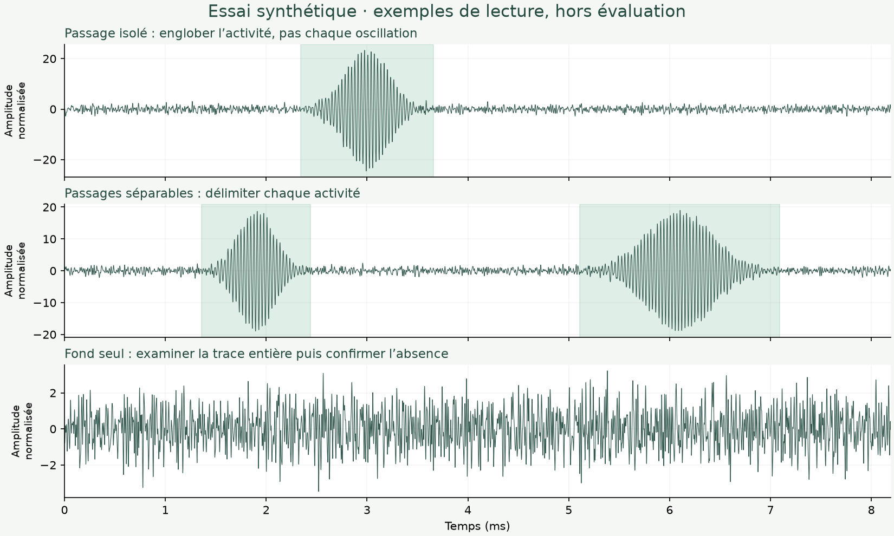

# Repérer et borner les événements

Travaille indépendamment, sans consulter les annotations d’un autre relecteur ni des résultats de détecteur. Ta familiarité avec ces données est utile pour les interpréter ; annote ici ce que tu observes sur chaque trace.

## Avant de commencer

L'annotation s'ouvre directement. Le lien Essai synthétique permet de tester les commandes hors évaluation. Lis ces consignes, puis annote sans choisir de nom. Une session locale est créée automatiquement.

## Ce qu’il faut délimiter

Un intervalle représente un passage physique reconnaissable, avec l’ensemble de son activité visible. Ne crée pas un événement pour chaque oscillation ou chaque pic d’un même passage. Inspecte toute la durée, même lorsqu’un passage paraît évident.

Place le début au premier écart attribuable au passage par rapport au fond local, et la fin au retour au fond. Utilise la vue brute pour garder le contexte, la vue filtrée pour travailler et le spectrogramme pour vérifier un cas ambigu. Ces indications décrivent un jugement visuel commun ; aucun seuil numérique de détecteur n’est à appliquer.

Trace des intervalles séparés lorsque des passages distincts sont reconnaissables. Si une superposition ne permet pas de les séparer, conserve l’intervalle observable, indique la difficulté « Nombre indéterminé » ou « Chevauchement » et explique brièvement le doute. N’invente pas de séparation pour obtenir un compte attendu.

Les zones colorées de l’exemple sont illustratives : elles montrent comment englober une activité, pas une réponse à reproduire sur les données de revue. Les traces de revue ne présentent aucun intervalle proposé.

## Les champs préremplis

Après deux clics sur les bornes (dans le sens de ton choix) ou un glisser, la nature est « Passage », la présence « Certaine », les bornes « Nettes », la censure et la difficulté « Aucune ». Conserve ces valeurs si elles correspondent à ton jugement, sinon modifie-les avant de valider.

- Présence incertaine : tu repères une activité, mais tu doutes qu’elle représente un passage. Conserve son intervalle et indique ce doute.
- Bornes incertaines : l’événement est repérable, mais le début ou la fin sont difficiles à placer. Indique tes meilleures bornes et signale l’incertitude.
- Censure : le passage est coupé par le début ou la fin de la trace. Borne jusqu’au bord observable et précise le côté.
- Difficulté : chevauchement, artefact, nombre indéterminé ou autre difficulté. Le commentaire apporte une précision si nécessaire.
- Nature « Artefact » : pour une activité que tu attribues à un artefact plutôt qu’à un passage. Elle sera conservée séparément des passages.

## Valider une trace

Sur le petit signal brut ou le grand signal filtré, clique sur une borne puis sur l’autre. Fin puis début fonctionne aussi : les bornes sont remises dans l’ordre. La première borne est montrée par un repère bleu. Échap annule cette première borne. Un glisser reste possible.

Vérifie la confiance, puis utilise « Valider cet événement » : tu restes sur la même trace. « Ajouter un événement », ou deux nouveaux clics en mode Dessiner, permet de délimiter le suivant sans effacer les précédents.

Lorsque tous les passages de la trace sont annotés, utilise « Terminer la trace et continuer » ou Entrée pour passer à la suite. Depuis un champ de saisie, Cmd+Entrée ou Ctrl+Entrée permet la même action.

Si tu conclus à l’absence de passage, utilise « Aucun événement » ou la touche 0. Une trace sans intervalle n’est jamais automatiquement négative. Si tu ne peux pas conclure, conserve ce que tu peux délimiter puis utilise « Trace incertaine » ou I ; elle ne sera pas assimilée à une absence.

D active le dessin. A permet de déplacer un intervalle ou ses extrémités. Z active le zoom. La touche 1 rétablit la trace entière ; 2 agrandit l’intervalle sélectionné. Annuler restaure une modification. Le graphe brut conserve toujours le contexte de la trace entière.

## Sauvegarder, reprendre et transmettre

La sauvegarde locale est automatique. Garde le même navigateur et le même dossier pour reprendre. Aucun nom n'est demandé : le coordinateur associera le JSON à son expéditeur.

Le bouton « Exporter le JSON » produit une sauvegarde partielle ou, quand toutes les traces sont validées, un export complet avec empreinte de contrôle. La copie locale reste modifiable. Chaque correction suivie d'un export produit un nouveau fichier ; conserver les fichiers précédents.

« Reprendre » importe une sauvegarde JSON dans une session vide compatible, sans écraser d'autres réponses. Ne pas attendre la fin de la revue pour faire une sauvegarde.

Envoie le JSON directement au coordinateur. Ne le dépose pas dans le dépôt partagé, une issue ou une pull request : l'autre relecteur ne doit pas le consulter avant de terminer.
